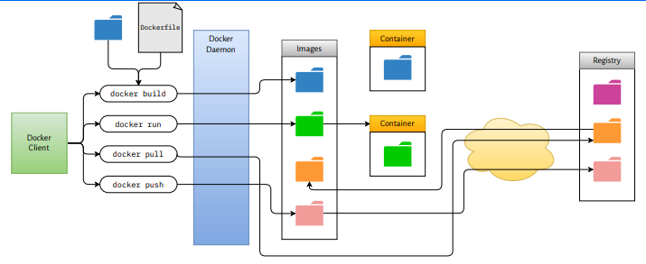

# Docker

Docker is a platform that lets you package an app and its dependencies into lightweight, portable containers. Each container runs from an image (a snapshot with your code, runtime, libraries, and config) on a shared OS kernel, providing isolated, reproducible environments. Benefits include consistent deployments across machines, fast startup, efficient resource use, and easy distribution via image registries. You typically build images with a `Dockerfile`, run them with `docker run`, and orchestrate multi-container setups with `docker compose`.

# Docker Fundamentals
### Containers vs. Virtual Machines
- Containers are lighter, start in seconds, and pack more densely
- VMs are heavier, boot slower, and use more CPU/RAM per instance.

### Dockerfile

A Dockerfile is a script of instructions that tells Docker how to build an image.It declares the base image, copies code/config, installs dependencies, sets env vars, exposes ports, and defines the default command/entrypoint so you can reproducibly create container images with `docker build`.

- Base image (`FROM`) --> Only FROM is strictly required;
- Working directory (`WORKDIR`)
- Dependency installation (`RUN npm install`, `pip install`, etc.)
- Source code copy (`COPY ./src /app/src`)
- Port exposure** (`EXPOSE 3000`)
- Startup command** (`CMD [“npm”, “start”]`)

You can create container images with docker build.

- Dockerfile → build image: `docker build -t <myapp-name>:<1.0> .`

### Images

A Docker image is a read-only package that bundles an app and everything it needs to run (code, runtime, libraries, config). It’s the template; when you run it, Docker creates a container—an isolated, writable instance based on that image.

- Images → `pull/list/remove: docker pull nginx:1.25`, `docker images`, `docker rmi <myapp-name>:<1.0>`

### Containers

A Docker container is a running, isolated instance created from an image. It uses the host’s OS kernel but has its own filesystem, processes, and network namespace, so the app inside runs consistently without affecting other services.

- Containers → `run/inspect/stop: docker run -d -p 8080:80 --name web nginx:1.25`, `docker ps -a`, `docker stop web`, `docker rm web`

# Data Persistence

### Docker Volumes

Managed storage that Docker creates and tracks under its own data directory (e.g., `/var/lib/docker/volumes`). Decouples data from container lifecycle and images, making it portable across container rebuilds. Best for production and when multiple containers need to share stable data.

### Bind Mounts vs Volumes

Bind mount: direct mapping from a host path to a container path; reflects host changes immediately, good for local dev/live code reloads; depends on host path existing and permissions. Volume: Docker-managed path; more portable, safer defaults, supports named references, and avoids coupling to specific host locations. Prefer volumes in most cases; use bind mounts when you must work with an existing host tree or live-edit source.

### Source and Destination Paths

Source (host side): the path on the host (for bind mounts) or the named volume identifier. Destination (container side): the path inside the container where the data appears. Syntax: `-v source:destination[:options]` (CLI) or `volumes: - source:destination` (Compose). Ensure destination paths match the app’s expected data/config locations; avoid overlapping mounts that can hide image content unintentionally.

### Data Persistence

Container filesystems are ephemeral: deleting a container removes its writable layer. Persist by mounting volumes or bind mounts so data outlives container lifecycle. Back up named volumes (e.g., docker run --rm -v myvol:/data -v $(pwd):/backup busybox tar ...) and manage lifecycle explicitly (docker volume ls/rm/prune). Plan for permissions (UID/GID), migration, and upgrades by keeping state in mounted storage, not inside the image.

# Orchestration

# Docker Architecture

### Docker Client

The Docker client is the command-line tool (`docker`) that you run to build, run, and manage containers. It speaks to the Docker daemon over the Docker API—sending your requests (build, run, pull, push) and showing the daemon’s responses.

### Docker Daemon

The Docker daemon (`dockerd`) is the background service that builds, runs, and manages Docker images, containers, networks, and volumes. It listens to the Docker API/CLI requests, handles container lifecycle, and coordinates resources on the host.

### Docker Registry

A Docker registry is a server that stores and distributes Docker images. You push images to a registry (`docker push`) and pull them back (`docker pull`). Examples: Docker Hub, GitHub Container Registry, AWS ECR, Google Artifact Registry, Azure Container Registry.

